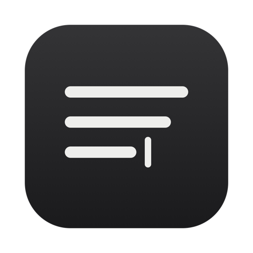
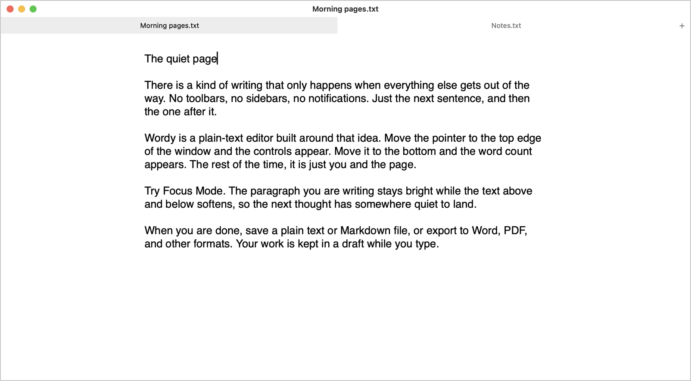
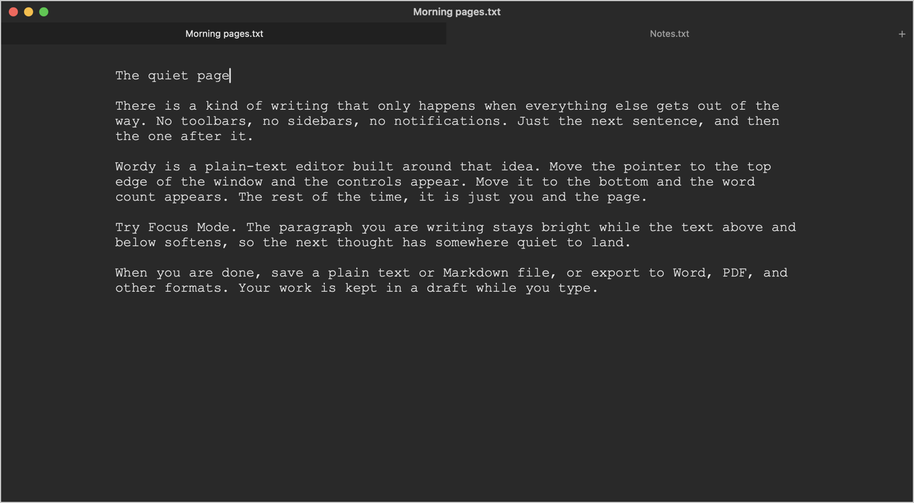
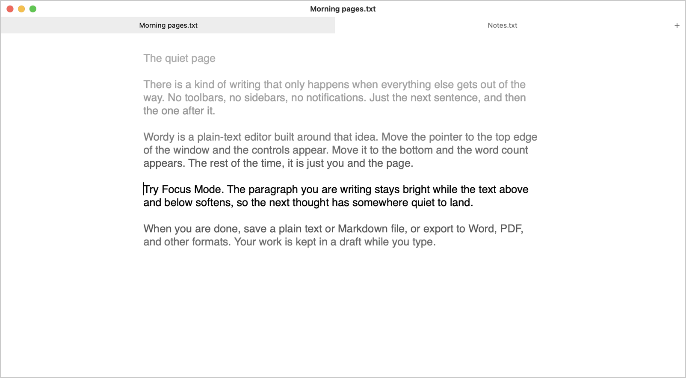

  

# Wordy

A simple, quiet text editor for macOS. Just you and the page.

> **Status: beta (v0.1).** It is young, so keep backups of anything irreplaceable.

**Download the latest release:** https://github.com/andresupreme/Wordy/releases/latest

## Screenshots

**White theme**

**Black theme** with the Typewriter font

**Focus Mode** keeps the current paragraph bright while the rest fades

## Requirements

- macOS 13 (Ventura) or newer
- To build it yourself: Xcode or the Command Line Tools (`xcode-select --install`)

## Install

**From a release:** download `Wordy.zip` from the [Releases page](https://github.com/andresupreme/Wordy/releases), unzip it, and drag
`Wordy.app` into Applications. The app is not notarized by Apple, so the first time,
right-click it, choose **Open**, then confirm. (If macOS still refuses, run
`xattr -cr /Applications/Wordy.app` in Terminal once.)

**From source:**

Unzip or clone the project, open Terminal in the project folder, then run:

    ./build_app.sh

That creates `build/Wordy.app` (with icon). Drag it into Applications. For quick
testing you can also use `swift run`. To build one app that runs on both Apple
Silicon and Intel Macs (needs full Xcode installed):

    UNIVERSAL=1 ./build_app.sh

To make Wordy the default app for .txt files: in Finder, select a .txt file, press ⌘I,
under "Open with" choose Wordy, then click "Change All…".

## Features

**Writing**
- Plain-text editor (native text view: undo/redo, find with ⌘F)
- Themes: White / Black (soft charcoal). Fonts: Helvetica / Courier (typewriter)
- **Appearance** menu: theme, font, line width (Narrow / Medium / Wide / Full), size (⌘+ or ⌘=, ⌘−)
- **Writing** menu: Typewriter Scrolling, Focus Mode, Spelling Check
- Focus Mode keeps the current paragraph bright and fades the text above and below
  it by distance; the previous paragraph dims the moment you press Enter
- Word and character count: move the cursor to the bottom edge of the window

**Minimal chrome**
- Title bar (buttons, title) fades in only when the cursor reaches the top edge of the window
- Full screen from **View > Toggle Full Screen** or ⌃⌘F

**Documents**
- Tabs: ⌘N opens a new tab. Closing a tab or window asks to save unsaved changes
- Autosave: unsaved text is kept on disk while you type; after a crash, or quitting
  with unsaved changes, it comes back at next launch
- Quitting with unsaved changes asks whether to save everything or keep drafts and quit
- Window position and size are remembered
- Open… (⌘O): .txt .md .rtf .html .docx .doc .odt .pdf (rich formats become plain text)
- Text in older encodings (for example Windows-1251 Cyrillic) is detected on open and
  saved back in the same encoding, so files from other programs are not changed
- Open Recent: the last files you opened or saved, in the File menu
- Save (⌘S) / Save As… (⇧⌘S): plain text
- Export… (⇧⌘E): .txt .md .rtf .html .docx .doc .odt .pdf
- Print… (⌘P)
- Double-click a supported file in Finder, or drop it on the Dock icon, to open it in Wordy

**Help menu** (⇧⌘/): getting started, all keyboard shortcuts, supported
formats, tips, and a shortcut to the saved-drafts folder.

Drafts are stored in `~/Library/Application Support/Wordy/Drafts`.

## Known limitations

- Opening rich documents (Word, RTF, HTML, ODT, PDF) keeps only the text; scanned PDFs
  cannot be read.
- Wordy does not notice if another program changes an open file; saving overwrites it.
- Tabs use a custom strip so they can follow the theme, so they cannot be dragged to
  reorder or into a new window.
- The interface is in English only.

## Tests

With Xcode installed, run the encoding and export tests with:

    swift test

## Sharing a build

`build_app.sh` ad-hoc signs the app so it runs on this Mac. To give it to
someone else without the warning, sign it with a Developer ID identity and notarize it:

    SIGN_IDENTITY="Developer ID Application: Your Name (TEAMID)" ./build_app.sh
    ditto -c -k --keepParent build/Wordy.app build/Wordy.zip
    xcrun notarytool submit build/Wordy.zip --wait --keychain-profile "notary"
    xcrun stapler staple build/Wordy.app

(notarytool only accepts a .zip, .pkg or .dmg, so the app is zipped first;
the ticket is then stapled to the .app itself.)

## License

MIT. See [LICENSE](LICENSE).
